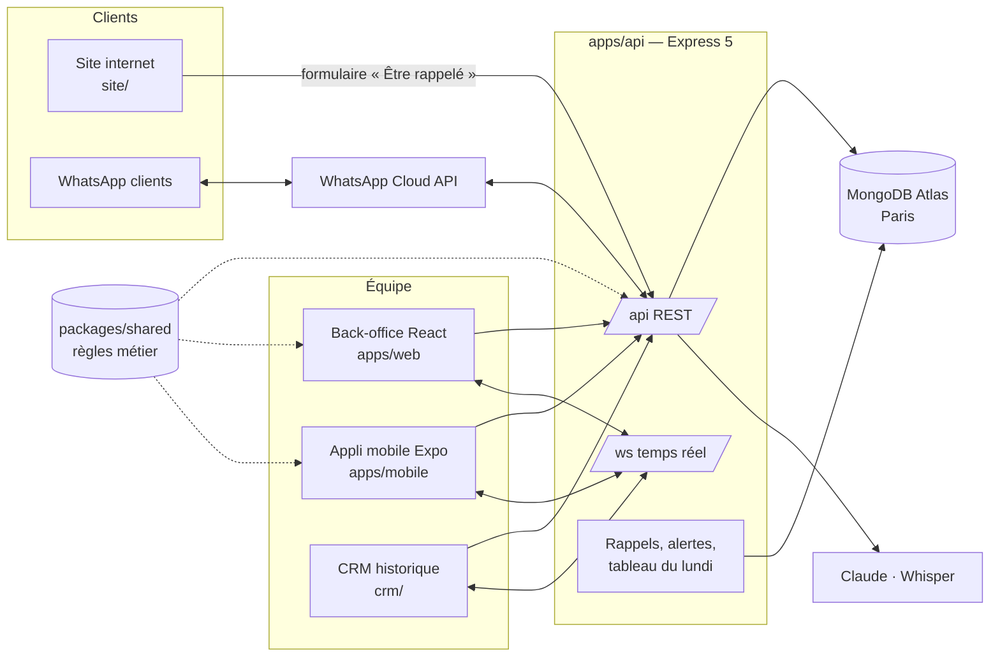

<p align="center">
  
</p>

<h1 align="center">Amane</h1>

<p align="center">
  Conciergerie privée à Paris : voitures d'exception, chauffeurs, vans, personal shopping et séjours.<br>
  <em>Arrive as a Guest. Leave with a Story.</em>
</p>

<p align="center">
  <a href="../../actions/workflows/ci.yml"></a>
</p>

Ce dépôt réunit tout le logiciel de la maison : le **CRM** de l'équipe (API, back-office web, CRM historique), l'**application mobile** et le **site internet**. Un seul serveur Node sert l'ensemble ; la base est MongoDB Atlas.

| | Pour qui | Où |
|---|---|---|
| **Back-office** (React) | Amel, Youssouf, Aziz : demandes, planning, clients, flotte, devis et factures, WhatsApp | `apps/web` → servi sur `/app` |
| **Application mobile** (Expo) | L'équipe en déplacement : appeler, répondre sur WhatsApp, voir la journée ; plus tard, les clients | `apps/mobile` |
| **API** (Express + MongoDB) | Tous les écrans ; webhook WhatsApp ; IA ; rappels automatiques | `apps/api` → `/api`, `/ws` |
| **CRM historique** (page unique) | Version d'origine, toujours compatible avec l'API | `crm/` → servi sur `/crm` |
| **Site internet** | Les clients : FR, EN, ES, AR | `site/` → servi sur `/` |

---

## Sommaire

- [Architecture](#architecture)
- [Démarrer en 5 minutes](#démarrer-en-5-minutes)
- [Structure du dépôt](#structure-du-dépôt)
- [Commandes](#commandes)
- [Configuration](#configuration)
- [Tests et qualité](#tests-et-qualité)
- [Déploiement](#déploiement)
- [Identité visuelle](#identité-visuelle)
- [Contribuer](#contribuer)

## Architecture



- **Une seule source de vérité** pour les règles métier (statuts, conflits de réservation, numérotation des devis, montants, langues) : `packages/shared`, utilisé par l'API, le back-office et l'appli.
- **Temps réel** : chaque écriture est diffusée sur `/ws` ; les écrans se mettent à jour sans recharger.
- **WhatsApp ne perd rien** : chaque message entrant est stocké, rattaché au client, traduit si besoin, et une alerte part si personne n'a répondu au bout de 6 h.
- Le contrat de l'API est décrit dans [`docs/crm-serveur.md`](docs/crm-serveur.md) (v1, toujours valable) et [`docs/architecture-v2.md`](docs/architecture-v2.md) (v2).

## Démarrer en 5 minutes

Prérequis : **Node 22** (`nvm use`), npm 10, Python 3 (scripts du site).

```bash
git clone https://github.com/YousCode/amane-app.git
cd amane-app
npm install
```

Lancer l'API en mode démo (base en mémoire, WhatsApp et IA simulés, aucun compte nécessaire) :

```bash
npm run api
```

→ http://localhost:3000 (site), http://localhost:3000/crm (CRM historique). Code PIN de démo : **1234** pour Amel, Youssouf et Aziz.

Le back-office avec rechargement à chaud, sur son faux serveur intégré (msw : aucune API nécessaire) :

```bash
npm run web
```

→ http://localhost:5173. Pour voir le back-office branché sur l'API locale : `npm run build`, puis http://localhost:3000/app.

L'appli mobile (Expo Go sur le téléphone, ou simulateur), pointée sur l'API du poste :

```bash
EXPO_PUBLIC_API_URL=http://<IP-du-poste>:3000 npm run mobile
```

Simuler un message WhatsApp entrant pendant le développement :

```bash
curl -X POST localhost:3000/__dev/inbound -H 'content-type: application/json' \
  -d '{"from":"33600000000","name":"Client Test","text":"Bonjour, une Urus samedi ?"}'
```

## Structure du dépôt

```
apps/
  api/          API Express 5 + MongoDB + WebSocket + tâches planifiées (Dockerfile, railway.json)
  web/          Back-office React 19 + Vite + TypeScript + Zustand (tests Vitest, e2e Playwright)
  mobile/       Appli Expo (SDK 58, Expo Router), iOS et Android — fr.amane.crm
packages/
  shared/       Règles métier communes (ESM + types .d.ts)
crm/            CRM historique en une page (crm/index.html) et ses parcours Playwright
crm-vercel/     Projet Vercel autonome du CRM historique (données dans le navigateur)
site/           Site internet (src.html → build.py → index.html ; make_vercel.py pour l'hébergement)
brand/          Logos et motif Arcades en SVG
docs/           Contrat d'API, architecture v2
guide/          Guide d'utilisation illustré pour l'équipe
.github/        CI, modèles d'issues et de pull requests, Dependabot
```

## Commandes

Toutes depuis la racine.

| Commande | Effet |
|---|---|
| `npm run api` | API en mode démo (`FAKE_DB=1 FAKE_AI=1`) sur le port 3000 |
| `npm run web` | Back-office en développement (Vite, port 5173, faux serveur msw) |
| `npm run mobile` | Serveur Expo |
| `npm run build` | Construit le back-office dans `apps/web/dist` (servi ensuite sur `/app`) |
| `npm start` | API en production (lit les variables d'environnement) |
| `npm test` | Tests unitaires : shared, API, back-office, mobile |
| `npm run typecheck` | Vérification TypeScript du back-office et de l'appli |
| `npm run test:crm` | Parcours complets du CRM historique (Playwright) |
| `npm run test:site` | Parcours du formulaire du site (Playwright) |
| `npm run build:vercel` | Régénère `site/vercel.html`, `site/crm/` et `crm-vercel/` après une modification du site ou du CRM |

## Configuration

Toutes les variables sont listées et commentées dans [`apps/api/.env.example`](apps/api/.env.example). En local, copier ce fichier en `apps/api/.env` (ignoré par Git).

| Variable | Obligatoire | Rôle |
|---|---|---|
| `MONGODB_URI`, `MONGODB_DB` | oui (hors démo) | Base MongoDB Atlas |
| `AUTH_SECRET` | oui | Signature des sessions (32 caractères minimum) |
| `AMANE_SETUP_CODE` | oui | Création et réinitialisation des codes PIN |
| `PUBLIC_URL` | en production | URL publique (liens de devis, espace client, CORS) |
| `WHATSAPP_*`, `TEAM_ALERT_NUMBERS` | non | WhatsApp Cloud API et alertes équipe |
| `ANTHROPIC_API_KEY`, `WHISPER_API_KEY` | non | IA (extraction, traduction, Majordome) et vocaux |
| `CRON_ENABLED` | sur une seule instance | Rappels clients, alertes, tableau du lundi |
| `CRM_ONLY` | non | `1` : le CRM à la racine, sans le site |

**Aucun secret ne va dans le dépôt.** Les valeurs vivent dans l'hébergeur (Railway, Render) et dans votre `.env` local. Voir [`SECURITY.md`](SECURITY.md).

## Tests et qualité

| Suite | Outil | Nombre |
|---|---|---|
| `packages/shared` | `node --test` | 21 |
| `apps/api` (API HTTP réelle, base en mémoire) | `node --test` | 85 |
| `apps/web` (règles, store, composants) | Vitest | 33 |
| `apps/mobile` | Jest | 28 |
| CRM historique : parcours, conciergerie, appareil, serveur | Playwright | 32 + 58 + 16 + 99 |
| Site : formulaire « Être rappelé » | Playwright | 12 |

La CI GitHub Actions ([`.github/workflows/ci.yml`](.github/workflows/ci.yml)) lance tout à chaque push sur `main` et sur chaque pull request : tests unitaires, TypeScript, build du back-office, puis les parcours Playwright. Une pull request ne se fusionne que si la CI est verte.

## Déploiement

| Pièce | Où | Comment |
|---|---|---|
| API + back-office + CRM + site | **Railway** (ou Render, Fly) | Docker : `apps/api/Dockerfile`, configuration lue dans `railway.json`. Variables : voir ci-dessus. Santé : `GET /api/health` |
| Base | **MongoDB Atlas** | Cluster `amane`, Paris (EU_WEST_3), base `amane`. Autoriser l'IP sortante de l'hébergeur dans *Network Access* |
| Site seul (option) | **Vercel** | Root Directory `site`, aucune commande de build. Le formulaire n'apparaît que si l'API répond |
| CRM historique seul (option) | **Vercel** | Root Directory `crm-vercel` ; données dans le navigateur de l'appareil |
| Appli mobile | **Expo EAS** | `cd apps/mobile && npx eas build` puis `npx eas submit` (profils dans `eas.json`) |
| WhatsApp | **Meta for Developers** | Webhook `https://<PUBLIC_URL>/api/whatsapp`, champ `messages` |

Pas à pas détaillé (Atlas, Railway, Meta, premiers codes PIN) : [`apps/api/README.md`](apps/api/README.md#déploiement).

## Identité visuelle

- Bordeaux `#5B1622` · bordeaux profond `#3B0C15` · champagne `#B8955C` · crème `#F6F1E8` · pierre `#EFE7DA` · encre `#15110F`
- Bodoni Moda (titres), Jost (texte)
- Le logo : l'arche à double filet, le losange au sommet, la serrure, la double ligne de base (`brand/`)

## Contribuer

Branches, messages de commit, revue, publication : [`CONTRIBUTING.md`](CONTRIBUTING.md).

---

© 2026 Amane. Code propriétaire, tous droits réservés : voir [`LICENSE`](LICENSE).
